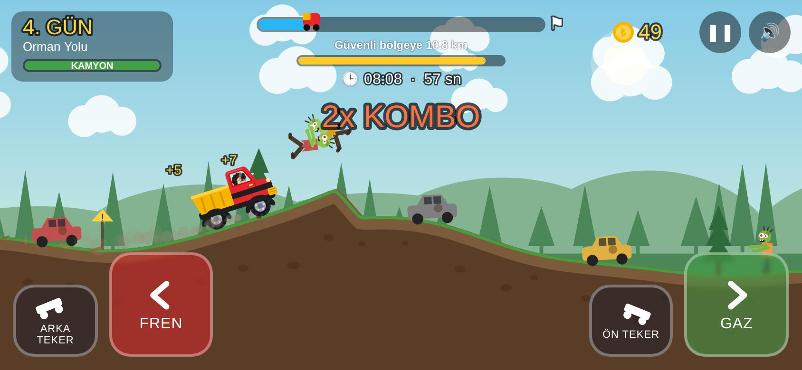

# 🚚 TUĞRA: SON VAPUR

Zombiler dünyayı ele geçirdi! Limandan kalkacak **son vapur** 10 gün sonra yola çıkıyor.
Tuğra kırmızı-sarı kamyonuna atlıyor, zombileri ezerek ve kutulardan kaçarak **10 gün içinde vapura yetişmeye** çalışıyor.



Oyun fikri: **Tuğra** · Yapım: Mehmet enişte

## Nasıl oynanır?

| Tuş (bilgisayar) | Telefon / tablet | Ne yapar? |
|---|---|---|
| `→` veya `D` | **GAZ** | Gaz |
| `←` veya `A` | **FREN** | Fren (durunca geri vites) |
| `↑` veya `B` | **ARKA TEKER** | Kamyon arka tekerin üstüne kalkar (şaha kalkar) |
| `↓` veya `N` | **ÖN TEKER** | Kamyon ön tekerin üstüne kalkar |
| `P` / `Esc` | ❚❚ | Duraklat |

- **10 gün = 10 bölüm.** Her gün hava kararmadan güvenli bölgeye ulaşmalısın. 10. günün sonunda limandaki SON VAPUR'a binersin.
- **Zombiler:** Hızlı çarparsan havaya uçarlar (+altın). Yavaş çarparsan kamyona vururlar.
  Üç çeşit zombi var: normal, koşucu ve şişko (şişkoyu ezmek için daha hızlı olmalısın).
- **Kutular:** Çarpınca kamyonu yavaşlatır. Üstlerinden atlamayı dene!
- **Elenme:** Kamyon ters dönerse, zombiler kamyonu parçalarsa ya da süre biterse elenirsin. **Süre her denemede yenilenir.**
- **Garaj:** Kazandığın altınlarla Motor, Zırh ve Dikenli Kepçe yükseltmeleri alabilirsin. Elensen bile altınlar sende kalır.
- İlerleme tarayıcıya kaydedilir (aynı telefon/bilgisayarda kaldığın yerden devam edersin).

## GitHub'a yükleyip link ile oynatmak (GitHub Pages)

1. GitHub'da yeni bir depo (repository) aç, adı örneğin `tugra-son-vapur` olsun. **Public** seç.
2. **Add file → Upload files** ile bu klasörün **içindekileri** (index.html, css, js, img klasörleri ve README.md) sürükleyip bırak, **Commit changes** de.
   > Önemli: `index.html` deponun en üst seviyesinde olmalı, başka bir klasörün içinde değil.
3. Depoda **Settings → Pages** bölümüne gir.
4. **Source:** `Deploy from a branch`, **Branch:** `main` ve `/ (root)` seç, **Save** de.
5. 1-2 dakika sonra oyunun linki çıkar:
   `https://KULLANICI-ADIN.github.io/tugra-son-vapur/`
   Bu linki Tuğra'ya gönder; telefonda, tablette ve bilgisayarda tarayıcıdan oynanır.

Telefonda daha rahat oynamak için: telefonu yan çevir. Android'de menüdeki **Tam Ekran** butonu da işe yarar;
iPhone'da Safari'de **Paylaş → Ana Ekrana Ekle** ile uygulama gibi açılır.

## Dosyalar

```
index.html        oyunun sayfası ve menüler
css/stil.css      görünüm (butonlar, menüler, dokunmatik tuşlar)
js/yardimci.js    yardımcı fonksiyonlar + kayıt (localStorage)
js/ses.js         tüm sesler (kodla üretilir, ses dosyası yok)
js/arazi.js       10 günün ayarları, yol/tepe/rampa üretimi, zombi ve kutu yerleşimi
js/araba.js       kamyon fiziği (süspansiyon, gaz, fren, şaha kalkma) ve çizimi + Tuğra'nın çizimi
js/zombi.js       zombiler, kutular, efektler
js/cizim.js       arka plan, yol, süsler, güvenli bölge kapısı ve SON VAPUR
js/kontrol.js     klavye ve dokunmatik tuşlar
js/oyun.js        ana döngü, kamera, ekran göstergeleri, menüler, garaj
```

Hiçbir kütüphane veya kurulum gerekmez; dosyaları açmak yeterli. Bilgisayarda denemek için `index.html` dosyasına çift tıklaman da olur.

### Kolay ayarlar
- Bölümlerin uzunluğu, zombi/kutu sayısı ve tepelerin büyüklüğü: `js/arazi.js` içindeki `BOLUMLER` listesi.
- Bölüm süresi: `js/arazi.js` içinde `sure:` satırı.
- Zombilerin hızı ve verdiği altın: `js/arazi.js` içindeki `ZOMBI_TIPLERI`.
- Yükseltme fiyatları: `js/oyun.js` içindeki `YUKSELTMELER`.
